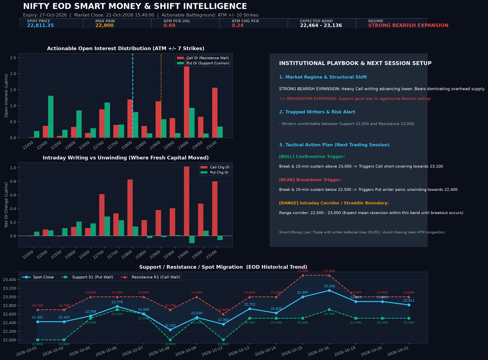

# 🧠 NIFTY EOD Smart Money & Directional Shift Intelligence
**Date:** `2026-10-21` | **Market Close:** `21-Oct-2026 15:40:00` | **Weekly Expiry:** `27-Oct-2026` | **Monthly Expiry:** `27-Oct-2026`

> ### 🔻 BREAKDOWN EXPANSION: Support gave way to aggressive Bearish selling!

## 📈 Executive Intelligence Card

## 🎯 Institutional Playbook & Action Plan for Next Session
**Market Regime:** `STRONG BEARISH EXPANSION` — *Heavy Call writing advancing lower. Bears dominating overhead supply.*

| Tactical Component | Strategy & Trade Trigger |
| :--- | :--- |
| 🟢 **Bullish Trigger** | **Break & 15-min sustain above 23,000 -> Triggers Call short covering towards 23,100** |
| 🔴 **Bearish Trigger** | **Break & 15-min sustain below 22,500 -> Triggers Put writer panic unwinding towards 22,400** |
| ⚖️ **Straddle Corridor** | **Range corridor: 22,500 - 23,000 (Expect mean reversion within this band until breakout occurs)** |
| 🎯 **Expected Expiry Band** | **`22,464 - 23,136`** (ATM Straddle: `336.3` pts) |
| 🛡️ **Major Support Floor (S1)** | **`22,500`** (Highest Put OI concentration) |
| 🧱 **Major Resistance Wall (R1)** | **`23,000`** (Highest Call OI concentration) |

### ⚡ Trapped Writers & Smart Money Footprint
- **Risk Alert:** Writers comfortable between Support 22,500 and Resistance 23,000.
- **Actionable ATM Battleground PCR (ATM ±10):** `0.69` *(Unpolluted by far OTM hedge skew)*
- **Intraday Additions PCR (ATM ±10):** `0.24` *(Where fresh margin was deployed today)*
- **Full Chain PCR:** `0.70` *(Included for reference; contains far OTM wing hedges)*

### 🔄 Day-over-Day Migration
- Spot Close: 22,888.95 -> 22,811.35 (-77.60 pts, -0.34%)
- Actionable ATM PCR: 0.92 -> 0.69 (-0.23)
- Max Pain Drift: 23,000 -> 22,900 (-100 pts)
- Range Migration: Support 22,500 (prev: 22,500) | Resistance 23,000 (prev: 23,000)

### 🗓️ Tactical Weekly vs Structural Monthly Alignment
- **Weekly Tactical View (27-Oct-2026):** `STRONG BEARISH EXPANSION` (ATM PCR: `0.69`)
- **Monthly Structural View (27-Oct-2026):** `STRONG BEARISH EXPANSION` (ATM PCR: `0.69`)
- **Alignment:** Weekly and Monthly trends are **congruent (STRONG BEARISH EXPANSION)**, reinforcing trend durability.

---
*Auto-generated by EOD OI Analysis Engine with browser TLS impersonation via curl_cffi. Full strike heatmap available in the HTML dashboard.*