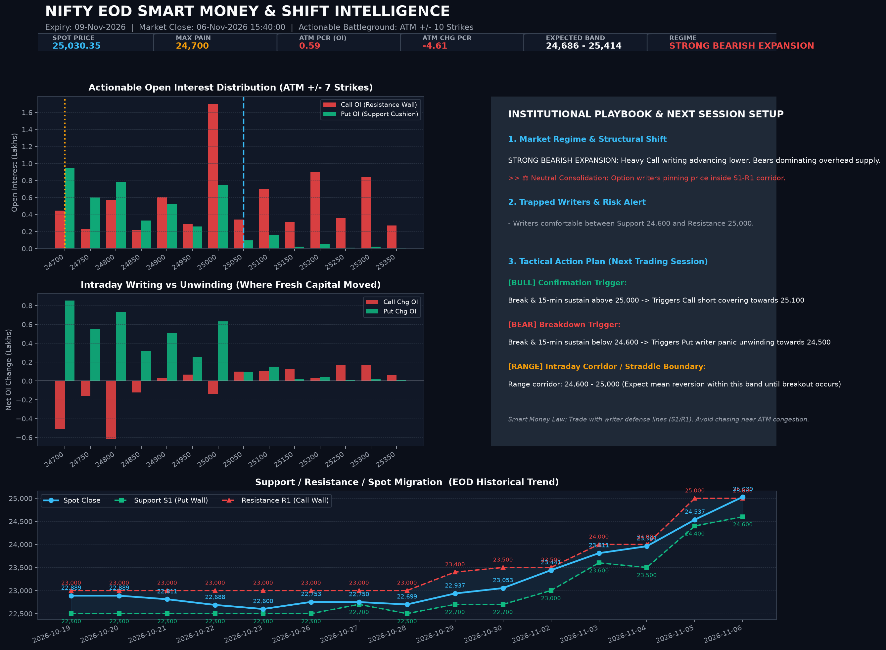

# 🧠 NIFTY EOD Smart Money & Directional Shift Intelligence
**Date:** `2026-11-06` | **Market Close:** `06-Nov-2026 15:40:00` | **Weekly Expiry:** `09-Nov-2026` | **Monthly Expiry:** `23-Nov-2026`

> ### ⚖️ Neutral Consolidation: Option writers pinning price inside S1-R1 corridor.

## 📈 Executive Intelligence Card

## 🎯 Institutional Playbook & Action Plan for Next Session
**Market Regime:** `STRONG BEARISH EXPANSION` — *Heavy Call writing advancing lower. Bears dominating overhead supply.*

| Tactical Component | Strategy & Trade Trigger |
| :--- | :--- |
| 🟢 **Bullish Trigger** | **Break & 15-min sustain above 25,000 -> Triggers Call short covering towards 25,100** |
| 🔴 **Bearish Trigger** | **Break & 15-min sustain below 24,600 -> Triggers Put writer panic unwinding towards 24,500** |
| ⚖️ **Straddle Corridor** | **Range corridor: 24,600 - 25,000 (Expect mean reversion within this band until breakout occurs)** |
| 🎯 **Expected Expiry Band** | **`24,686 - 25,414`** (ATM Straddle: `364.0` pts) |
| 🛡️ **Major Support Floor (S1)** | **`24,600`** (Highest Put OI concentration) |
| 🧱 **Major Resistance Wall (R1)** | **`25,000`** (Highest Call OI concentration) |

### ⚡ Trapped Writers & Smart Money Footprint
- **Risk Alert:** Writers comfortable between Support 24,600 and Resistance 25,000.
- **Actionable ATM Battleground PCR (ATM ±10):** `0.59` *(Unpolluted by far OTM hedge skew)*
- **Intraday Additions PCR (ATM ±10):** `-4.61` *(Where fresh margin was deployed today)*
- **Full Chain PCR:** `1.65` *(Included for reference; contains far OTM wing hedges)*

### 🔄 Day-over-Day Migration
- Spot Close: 24,536.60 -> 25,030.35 (+493.75 pts, +2.01%)
- Actionable ATM PCR: 0.69 -> 0.59 (-0.10)
- Max Pain Drift: 24,350 -> 24,700 (+350 pts)
- Range Migration: Support 24,600 (prev: 24,400) | Resistance 25,000 (prev: 25,000)

### 🗓️ Tactical Weekly vs Structural Monthly Alignment
- **Weekly Tactical View (09-Nov-2026):** `STRONG BEARISH EXPANSION` (ATM PCR: `0.59`)
- **Monthly Structural View (23-Nov-2026):** `RANGEBOUND CONSOLIDATION` (ATM PCR: `0.50`)
- **Alignment:** **Tactical divergence detected** between weekly momentum (`STRONG BEARISH EXPANSION`) and monthly backdrop (`RANGEBOUND CONSOLIDATION`). Anticipate chop at S1/R1 boundaries.

---
*Auto-generated by EOD OI Analysis Engine with browser TLS impersonation via curl_cffi. Full strike heatmap available in the HTML dashboard.*