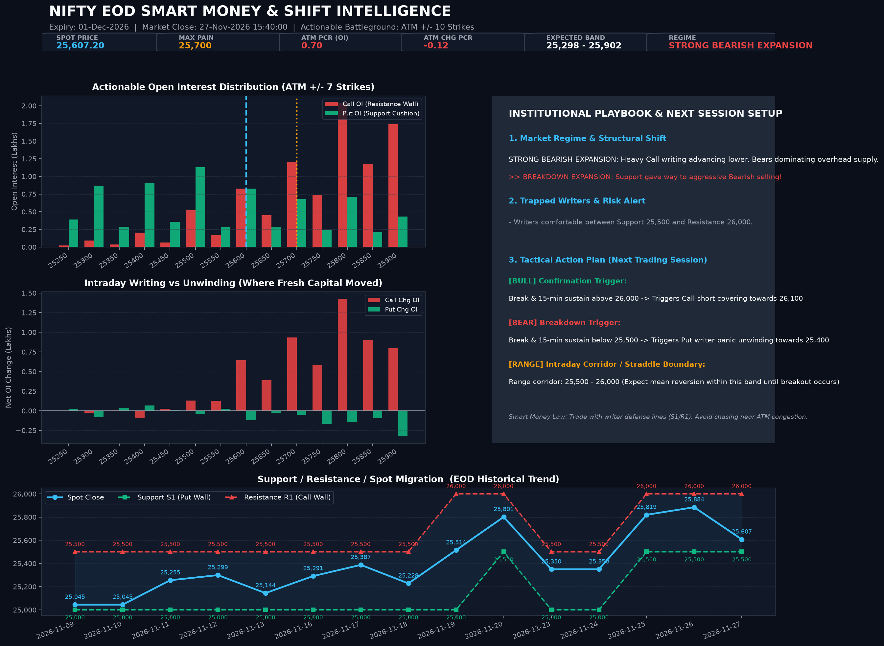

# 🧠 NIFTY EOD Smart Money & Directional Shift Intelligence
**Date:** `2026-11-27` | **Market Close:** `27-Nov-2026 15:40:00` | **Weekly Expiry:** `01-Dec-2026` | **Monthly Expiry:** `29-Dec-2026`

> ### 🔻 BREAKDOWN EXPANSION: Support gave way to aggressive Bearish selling!

## 📈 Executive Intelligence Card

## 🎯 Institutional Playbook & Action Plan for Next Session
**Market Regime:** `STRONG BEARISH EXPANSION` — *Heavy Call writing advancing lower. Bears dominating overhead supply.*

| Tactical Component | Strategy & Trade Trigger |
| :--- | :--- |
| 🟢 **Bullish Trigger** | **Break & 15-min sustain above 26,000 -> Triggers Call short covering towards 26,100** |
| 🔴 **Bearish Trigger** | **Break & 15-min sustain below 25,500 -> Triggers Put writer panic unwinding towards 25,400** |
| ⚖️ **Straddle Corridor** | **Range corridor: 25,500 - 26,000 (Expect mean reversion within this band until breakout occurs)** |
| 🎯 **Expected Expiry Band** | **`25,298 - 25,902`** (ATM Straddle: `302.0` pts) |
| 🛡️ **Major Support Floor (S1)** | **`25,500`** (Highest Put OI concentration) |
| 🧱 **Major Resistance Wall (R1)** | **`26,000`** (Highest Call OI concentration) |

### ⚡ Trapped Writers & Smart Money Footprint
- **Risk Alert:** Writers comfortable between Support 25,500 and Resistance 26,000.
- **Actionable ATM Battleground PCR (ATM ±10):** `0.70` *(Unpolluted by far OTM hedge skew)*
- **Intraday Additions PCR (ATM ±10):** `-0.12` *(Where fresh margin was deployed today)*
- **Full Chain PCR:** `0.59` *(Included for reference; contains far OTM wing hedges)*

### 🔄 Day-over-Day Migration
- Spot Close: 25,884.50 -> 25,607.20 (-277.30 pts, -1.07%)
- Actionable ATM PCR: 0.84 -> 0.70 (-0.14)
- Max Pain Drift: 25,800 -> 25,700 (-100 pts)
- Range Migration: Support 25,500 (prev: 25,500) | Resistance 26,000 (prev: 26,000)

### 🗓️ Tactical Weekly vs Structural Monthly Alignment
- **Weekly Tactical View (01-Dec-2026):** `STRONG BEARISH EXPANSION` (ATM PCR: `0.70`)
- **Monthly Structural View (29-Dec-2026):** `RANGEBOUND CONSOLIDATION` (ATM PCR: `1.07`)
- **Alignment:** **Tactical divergence detected** between weekly momentum (`STRONG BEARISH EXPANSION`) and monthly backdrop (`RANGEBOUND CONSOLIDATION`). Anticipate chop at S1/R1 boundaries.

---
*Auto-generated by EOD OI Analysis Engine with browser TLS impersonation via curl_cffi. Full strike heatmap available in the HTML dashboard.*